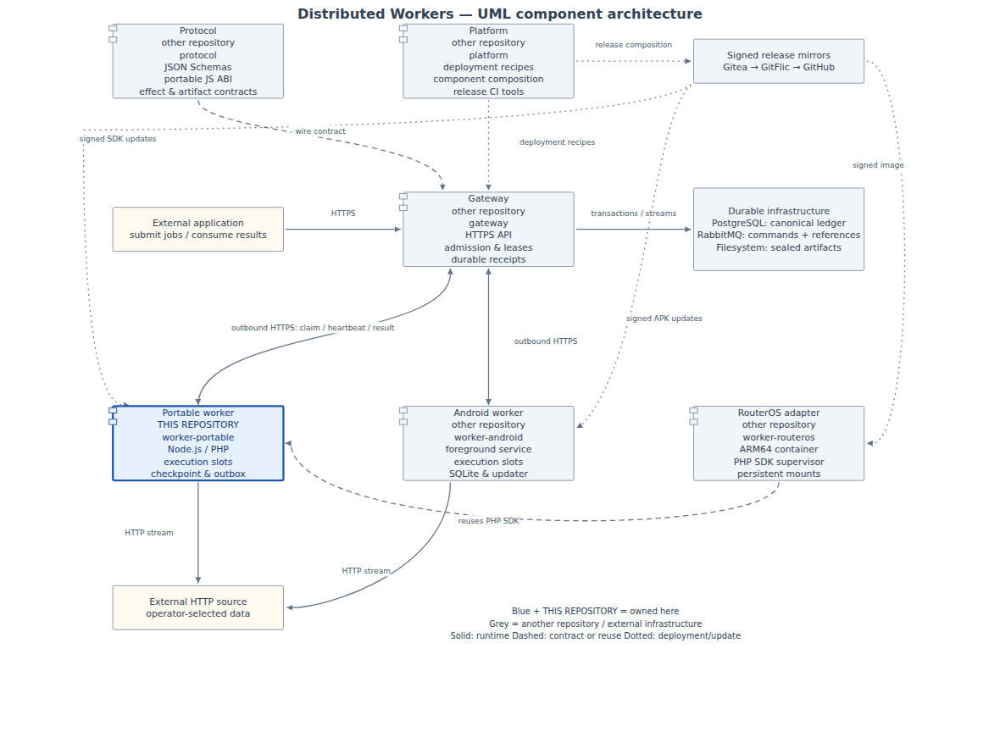

# Portable worker

Node.js 24+ runs on Linux, Windows and supported CPU architectures. PHP 8.2+ is a CLI/cron adapter for shared hosting. Both implement `sha256`, `http.request` and streamed binary artifacts. The common text operation uses NFC and Android’s exact whitespace/space-character union; U+0085/U+FEFF remain literal. Both compute operations require a string `input.text`. Node implements `text.normalize`; PHP advertises it only when `intl` is installed. PHP does not advertise JavaScript.

<!-- fleet-architecture:start -->
## Architecture and repository boundary



All six repositories show the same system. **Blue and “THIS REPOSITORY” identify the component owned here**; grey boxes show sibling repositories or external infrastructure. Solid arrows carry runtime traffic, dashed arrows show contracts or reuse, and dotted arrows show deployment or updates. The protocol applies to the gateway and both execution SDKs; deployment arrows show the principal composition entry points.

This repository owns the Node.js and PHP execution adapters: platform operations, resource admission, independent slot state, checkpoints, completion outboxes, binary streams and signed SDK updates. The gateway owns the canonical job ledger.

Implementation: [Node adapter](node/worker.mjs), [PHP adapter](php/worker.php), [Node admission](node/concurrency.mjs), [PHP admission](php/concurrency.php).

[SVG source](docs/architecture.svg) · [Editable DOT source](docs/architecture.dot). The common model and Python-only SVG renderer live in [platform](https://gitflic.ru/project/distributed-workers/platform). From its checkout, `python3 -B tools/render-architecture.py --workspace ../.. --png` regenerates every ownership view in a workspace containing `repos/<component>`. PNG previews work on forges that serve SVG as text. SVG generation uses Python alone; PNG rendering uses a local Chromium browser. No diagram service or production configuration is needed.
<!-- fleet-architecture:end -->

Use one backend and a private state directory per installation. A device/enrollment token is enough for a new installation: the first connection assigns a stable server ID and durably saves it before any heartbeat, claim or completion. Existing device tokens retain their IDs; an existing `worker_id` remains supported. Retrying a connection with the same token recovers the same identity after a lost response. Changing identity while local work is pending is refused and preserves its state. Keep the device token and all deployment addresses in an owner-readable configuration outside this repository.

```json
{
  "gateway": "https://gateway.example.invalid",
  "token": "configure-privately",
  "state_directory": "/var/lib/portable-worker",
  "trusted_javascript": false,
  "chunk_bytes": 262144,
  "update_poll_seconds": 900
}
```

Connections, worker heartbeats and claims carry `X-Worker-Profile`, a base64url JSON header with schema 1, exact advertised capabilities and numeric resource fields. CPU availability applies visible affinity/cgroup quotas; RAM applies visible cgroup/runtime limits, including Node's actual V8 heap headroom and PHP `memory_limit`. Disk space describes the state directory's filesystem. GPU VRAM is reported where Linux DRM exposes it; compute units and unified memory remain `null` when unknown. CUDA core counts are not inferred from GPU models. An unavailable GPU probe reports `unknown`, not `none`. Discovery failures leave nullable values and do not prevent ordinary work. Profiles contain no hostnames, models or serial numbers. Devices use only their own token; administrative enrollment creation and other workers' data are outside this runtime.

Start Node with `node node/bootstrap.mjs /private/worker.local.json`. On shared hosting, schedule `php php/bootstrap.php /private/worker.local.json --drain` using the provider's cron. Drain runs process ready tasks until the queue is empty; `--once` remains available for one task. An overlapping cron invocation leaves before reading mutable state, while the existing process retains its lock. Keep code, credentials and state outside the website's document root. The PHP runtime needs `curl`, `openssl`, `zlib` and `Phar`; `intl` is optional. A provider's actual wall-time allowance may be supplied as `host_window_seconds`. It is a resumable execution window, not a task deadline. PHP's `max_execution_time` has platform-dependent CPU/wall-time semantics; do not assume it describes the hosting provider's cron limit.

A stop signal closes task admission, drains any already claimed task and
preserves its durable completion. It
also takes precedence over an update restart: a runtime exit 75 cannot start a
new child after the bootstrap has received SIGTERM/SIGINT. No new update check
is started after stop; an update already in progress may finish its atomic
installation before the process exits normally.

The bootstrap selects the last verified installed version. A Node child exit 75 reloads that version. PHP cron loads it at the next invocation; a PHP daemon supervisor should restart exit 75. A service supervisor must allow healthy long jobs to drain or retain their durable state rather than impose an unrelated startup/job timeout.

`trusted_javascript: true` adds `javascript` and `javascript.portable.v1`. A task uses synchronous ES5.1 `run(input, resume, ctx)`. `ctx.progress`, `ctx.checkpoint` and `ctx.http.request` are synchronous host calls; legacy global `progress` and `checkpoint` work as well. The Node task process receives no worker token/config/environment. It uses a separate process and Node permissions as protection against accidental access. **Node `vm` and Node permissions are not security boundaries for hostile code.** Enable this capability only for trusted operator code; use a separate OS account/container with its own restrictions for stronger isolation. See the [Node security guidance](https://nodejs.org/api/permissions.html).

A declarative HTTP task and `ctx.http.request` share this object:

```json
{
  "effect_id": "download-document",
  "url": "https://example.org/document.pdf",
  "method": "GET",
  "replay": "safe",
  "response": {"mode": "artifact", "name": "document.pdf"}
}
```

`body_text` is supported; `body_artifact_id` is not advertised in this version. Response header names are lowercase and every value is a string array, retaining duplicate headers. Responses contain status, headers, final URL and a sealed `{artifact_id,length,sha256,media_type,name}` reference. `text`/`json` inline modes require an explicit `max_bytes`. When the encoded completion exceeds the gateway’s actual 16 MiB JSON budget, HTTP inline views fall back to their full source artifact; other computed results stream into a JSON artifact with `result_format: "json"`. Both expose `control_budget_exceeded`. Overflow, invalid UTF-8 or invalid JSON return the **full** artifact and a `body_error`, without truncation. HTTP error responses remain inspectable HTTP results.

PHP additionally checks its actual heap before materializing text or expanding
JSON. `inline_memory_budget_exceeded` retains the full sealed artifact when the
representation would not fit; it does not request the source again. Inline
artifact reads renew leases, observe cancellation and yield at an actual host
execution window. Restricted telemetry functions may remain unavailable without
preventing supported compute/network jobs. PHP advertises `runtime.php.v1` so
jobs can explicitly select that implemented backend when needed.

Source entity bytes are preserved after transfer framing and before content decoding. Default source headers are `Accept: */*`, `Accept-Encoding: identity`, `User-Agent: DistributedWorker/1`. Explicit compressed responses retain their compressed bytes and `Content-Encoding`.

Network restrictions can be set in the worker config and in `job.network`: `origins`, `methods`, `request_headers`, `response_modes`. Restrictions intersect. A missing dimension is unrestricted; `[]` denies it. Redirects recheck restrictions. Cross-origin redirects remove caller headers except Accept, Accept-Encoding, User-Agent and Content-Type, and are followed only when the resulting method is GET/HEAD. Unsafe cross-origin redirects return the original response for an explicit new request/effect. Rewrites to GET remove entity headers. `redirect: "manual"` returns the original response. Optional `timeouts.connect_ms` and `timeouts.read_idle_ms` control connection setup and actual source-read inactivity, with zero disabling the framework timer. Deliberate gateway backpressure is excluded from source idle time. Redirect cycles return their response; no fixed redirect-attempt budget terminates legitimate chains.

Before any vendor HTTP, the gateway reserves the effect using a fresh execution UUID and computes the normalized request hash. The same UUID is reused only for an uncertain reservation RPC before vendor dispatch. A restarted call has a new UUID. `never` effects with an uncertain previous dispatch are not automatically repeated. `idempotent` requires a nonempty `idempotency_key`; the actual outgoing header must match it. This is an assertion about the vendor's idempotency contract, not a claim of universal exactly-once HTTP.

Binary task bodies flow from source to bounded chunks to the gateway. Workers never stage task binaries in files or completion JSON. Each durable chunk ACK advances the checkpoint. Strong ETag + Range allow resumption; a changed/non-rangeable source starts a new retained upload. A lost finish ACK is recovered from the sealed artifact without requesting the source again. Partial artifacts and uncertain external effects remain evidence rather than being presented as successful tasks. Local JSON metadata and completion outbox use atomic replacement and fsync. Only a matching committed/candidate-saved receipt removes a completion. Permanent non-authentication 4xx conflicts are moved atomically into a local forensic quarantine, retaining payload and server response while allowing future tasks. Checkpoints and sealed artifact ownership persist per job, including a resumed script returning a saved artifact without a fresh HTTP call; cleanup happens only after the matching durable completion ACK. Leases renew independently of long Node compute; cancellation closes streams/child execution. A host interruption may leave an uncertain external effect, which must be reconciled rather than blindly retried.

Self-updates check the configured Gitea → GitFlic → GitHub sources. Public defaults contain a reserved Gitea hostname; provision a real Gitea URL only in private config. The same pinned RSA key verifies every source, and a durable version floor prevents rollback. A source reporting the installed version does not hide a newer fallback. The signed ZIP/hash is verified, paths/links/CRC/package identity are checked, then a version directory and activation pointer are installed atomically. Updates run only outside an active task with an empty outbox. `runtime/pending.zip` is an updater package cache, not a task payload. A different payload never overwrites an already installed version.

Tests use controllable localhost fixtures only:

```sh
node --test tests/*.test.mjs
PHP_BINARY=/usr/bin/php node --test tests/*.test.mjs
```

The first command uses an already installed official `php:8.3-apache` Docker image when `PHP_BINARY` is absent. CI uses native PHP 8.2 with no Docker socket. Tests exercise 64 MiB binary transfers, bounded memory, lost ACKs, resumed ranges, cancellation, real PHP execution windows, durable outboxes, redirect credential handling, compressed entity bytes and signed updates. They do not contact deployment services or public release APIs.

## Opt-in native programs (Node and available PHP hosts)

The `command.run` backend executes operator-provisioned programs without adding
application modules to the worker. It is disabled when `commands` is absent.
Configure opaque IDs in the private worker configuration:

```json
{"commands":{"transform-v1":{
  "executable":"/opt/application/bin/transform",
  "argv":[],
  "sha256":"aaaaaaaaaaaaaaaaaaaaaaaaaaaaaaaaaaaaaaaaaaaaaaaaaaaaaaaaaaaaaaaa",
  "capability":"program.transform.v1",
  "replay":"never",
  "env":{"PATH":"/usr/bin:/bin"},
  "media_type":"application/x-tar",
  "name":"result.tar",
  "stderr_bytes":16384
}}}
```

The executable must be an available executable file with the exact configured
SHA-256. The worker advertises `command.run.v1` and the configured version
capabilities only for currently usable entries. Idle admission caches the exact
file identity/size/mtime/ctime fingerprint; each new launch hashes the opened
executable again and checks its fd/stat stability.
Provision binaries and dependencies separately under operator-controlled immutable
paths. No command or application binary is downloaded from a task. A job is
`{operation:"command.run",input:{program:"transform-v1",payload:{...}},required_capabilities:["command.run.v1","artifact.stream","program.transform.v1"]}`.
There is no task-supplied path, argv, environment or shell. The fixed process
receives only `payload` as UTF-8 JSON stdin. Its environment is empty except for
Windows SystemRoot and explicitly configured fixed values, allowing dependencies
without inheriting worker credentials/configuration. Do not put secrets in the
public program manifest or task payload.

Stdout is streamed byte-for-byte to a gateway artifact with bounded memory and
backpressure; no local stdout file is created. `result` contains `artifact`,
`exit_code` (null when signalled), optional `signal`/`error_code`, and
`stderr:{tail_base64,bytes,retained_bytes,truncated}`. Stderr is a bounded tail,
separate from the data, and is never logged in full. Nonzero exit produces a
failed completion retaining its output. Cancellation or lease loss kills the
process tree and seals captured output where possible. Lost chunk/seal ACKs retry
the same bytes; durable completed output/exit metadata and sealed results resume
without starting the program again. Only the matching completion ACK clears the
command record.

Interrupted started execution is uncertain with the default `replay:"never"`.
Set `safe` only for independently repeatable work with application idempotency.
Recovery then starts a new retained upload generation; it never appends new
process output to an old partial stream. There is no native incremental
checkpoint channel or cross-host process migration in this baseline. Prefer one
independent resumable unit per job; a job has no added overall deadline.

A native process is trusted operator code with its OS account's access. It is
not a sandbox, and its HTTP calls do not use the worker effect journal or HTTP
host policy. Nonempty `job.network` is rejected. A worker with a nonempty local
network allow-policy does not advertise native commands. Supply real restrictions
through OS/container isolation or the program's own validated inputs. Node process
trees are killed as a Unix process group or with Windows taskkill; programs must
not deliberately detach from that supervision. Hard worker/host crashes require
OS service/container lifecycle supervision. PHP advertises native work only when its process/pipe functions and configured
executable are actually usable. Linux PHP additionally cleans up descendants
using birth-identity-checked `/proc` records when `posix_kill` is available;
restricted hosts rely on the configured program's cooperative termination.
Android does not advertise native commands.

Task-only proxy configuration, verified source caches, failover and the native
process environment contract are described in [PROXY.md](PROXY.md).

Idle workers use commit-driven long polling when the gateway supports it; older gateways retain polling fallback. Control connections are reused. PHP write controls open fresh connections to avoid libcurl silently replaying an uncertain write. Idle wait windows never limit task execution or result streams.

## Adaptive parallelism

Long-running Node and PHP adapters dynamically admit separate execution slots
under one identity. State for slot zero remains in the existing directory;
additional state lives under `slots/<number>`. Transport retries and restarts
retain each slot's checkpoints and completion outbox. Owner work is protected
by lower OS priority, CPU headroom and memory reserves. Pressure stops new
admission while productive work drains. Updates wait for all slots to drain.

Private configuration can set `concurrency.mode` to `shared` (default),
`batch` (idle servers) or `router`. `cpu_per_job_cores` (default 1) and
`memory_per_job_bytes` (default 134217728) are admission estimates, not job
execution limits. The initial memory estimate covers the control envelope,
serialization and a child runtime; operators can set an observed workload
reservation. Unknown telemetry keeps at most one slot. There is no fixed
thread-count ceiling; CPU and memory determine capacity.

PHP finite `--once` and legacy `--drain` remain compatible. Setting
`concurrency.enabled: true` enables the pool for cron `--drain` as well. A
host disabling child-process creation retains the serial adapter. The parent
retains the legacy root-state lock, including while slot zero adopts that lock,
so overlapping cron invocations cannot overwrite active state.

Private state controls are available on every managed adapter: `admission-drain`
pauses new work; `runtime-stop` drains productive executions and exits. Removing
the files permits the supervisor to restart normally. Windows administrators
can use these controls before stopping a scheduled task, without relying on
POSIX signals or terminating active native children.

Process admission also reads visible cgroup PID quotas and the account NPROC limit.
Linux accounts charge OS threads as well as child processes. The scheduler leaves
the same owner reserve and uses an initial reservation of 16 process/thread units
per execution; operators can set `concurrency.processes_per_job` from measurements
of their configured programs. This is an admission estimate, not a runtime limit.
Already accepted executions continue and admission resumes as the quota frees.

<!-- fleet-examples:start -->
## Runnable examples and measured results

A local computation needs no source service:

```json
{
  "operation": "sha256",
  "input": {
    "text": "abc"
  },
  "required_capabilities": [
    "sha256"
  ]
}
```

Expected result: `{"sha256":"ba7816bf8f01cfea414140de5dae2223b00361a396177a9cb410ff61f20015ad"}`. The same task runs on Node, PHP and Android.

The [binary download example](https://github.com/hawkab/distributed-workers-protocol/blob/main/examples/mirror-download.json) fetches a public signed runtime ZIP and streams it to gateway artifact storage. Its expected SHA-256 is pinned in [the example assertions](https://github.com/hawkab/distributed-workers-protocol/blob/main/examples/benchmark/expected.json). The runner downloads the sealed artifact independently and verifies every byte. Worker task payloads are not staged as local files.

Run the shared client as a **producer/operator with an administrator credential**, not with a worker token. Keep the [protocol checkout](https://gitflic.ru/project/distributed-workers/protocol) beside this checkout:

```sh
mkdir -p .local
cp ../protocol/examples/benchmark/runner.example.json .local/examples.local.json
# Configure your API base and an owner-readable token file in that local JSON.
python3 -B ../protocol/tools/run-examples.py \
  --config .local/examples.local.json \
  --state .local/example-run/state.json \
  --output .local/example-run/measurements.json \
  --scenario sha256 --scenario mirror-download --repetitions 5
```

Repeat the command to resume its saved jobs after interruption. It reconciles the same idempotency keys, retains failed/interrupted evidence, and never gives a running job an overall deadline. `required_capabilities` and `resource_requirements` select a pool; `allowed_worker_ids` checks the actual executor afterward. A label alone does not select a platform. Keep these routing settings and all identity receipts private. The exported measurements contain neither endpoints, credentials nor worker/job IDs.

Measured 26–27 November 2026 (UTC+03), using SDK 0.8.4 and Android 0.8.0.

| Executor | Task | Completed / planned | Queue, median s | Execution/result, median s |
| --- | --- | --- | --- | --- |
| Node / Linux | SHA-256: abc | 5 / 5 | 0.032 | 0.795 |
| PHP / shared hosting | SHA-256: abc | 5 / 5 | 1.456 | 0.899 |
| Node / Linux | ZIP stream: GitFlic | 5 / 5 | 0.029 | 83.887 |
| PHP / shared hosting | ZIP stream: GitFlic | 3 / 5* | 0.362 | 33.910 |

\* Incomplete download cohort: timing uses only verified completions. Cancelled and unstarted trials remain in the full report. One completed transfer is a functional check, not an estimate of typical throughput.

Times distinguish queue wait from execution **including task work and result delivery**. They are live-system observations under existing load, not pure CPU timings. Complete cohorts use five trials each; see the [full measurements and method](https://github.com/hawkab/distributed-workers-protocol/blob/main/docs/EXAMPLES.md).
<!-- fleet-examples:end -->
